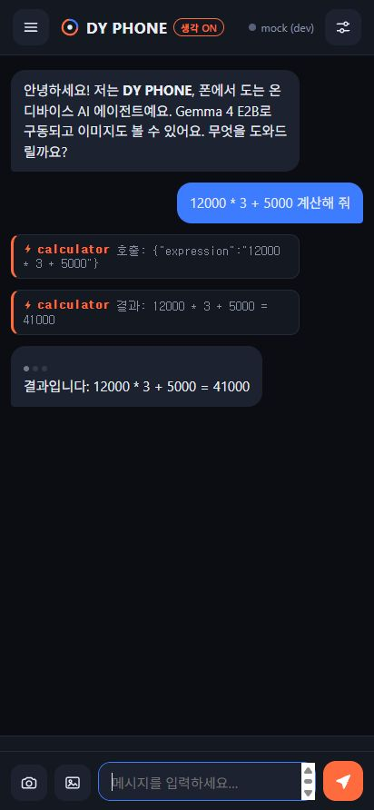
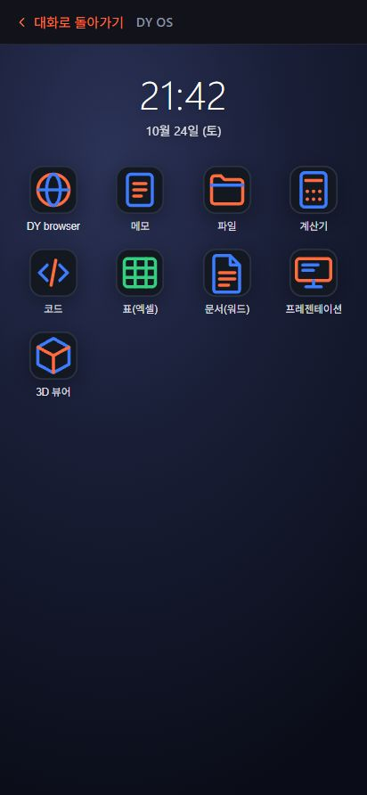
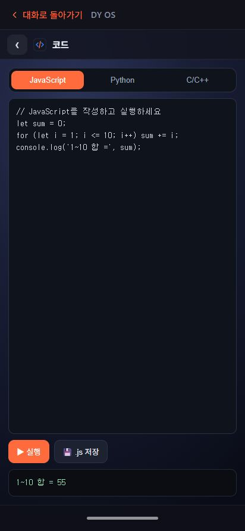

# DY PHONE

Chat with an on-device AI assistant and use the **DY OS workspace** to manage files, edit documents, and run code on Android. The app interface is in Korean.

[**Download the Android APK for ARM64 phones**](https://github.com/DY-AGENT/DY-PHONE/releases/download/v3.19.0/DY-PHONE-3.19.0-arm64-v8a.apk) · [Release notes and downloads](https://github.com/DY-AGENT/DY-PHONE/releases/tag/v3.19.0)

| Chat and calculator | DY OS workspace | Code editor |
| --- | --- | --- |
|  |  |  |

These screenshots show the web interface running in Chrome at 412 × 892 CSS pixels. The chat uses the `mock (dev)` backend. The [validation record](docs/VALIDATION.md) lists the browser checks and the Android features that still need testing on a device.

## What you can do

| Task | Where to do it |
| --- | --- |
| Ask questions, switch thinking mode, or run a calculation | Chat and tool calls |
| Find a workspace app | DY OS home screen |
| Take notes, browse files, or preview a file | Notes and Files |
| Write and run short programs | JavaScript, Python, and C/C++ code editors |
| Create spreadsheets, documents, or slides | Spreadsheet, document, and presentation editors |
| Open an image or a 3D file | Image attachments, file previews, and the 3D viewer |

DY OS runs inside DY PHONE. Its tools operate within that workspace. Some features and file formats require native plugins or bundled libraries.

## Install the Android app

1. On a 64-bit ARM phone running Android 7.0 or later, download and open the [ARM64 APK](https://github.com/DY-AGENT/DY-PHONE/releases/download/v3.19.0/DY-PHONE-3.19.0-arm64-v8a.apk).
2. If Android prompts you, enable **Allow from this source** for the browser or file manager that opened the APK, then install it.
3. Open DY PHONE and download the model from the model settings screen. Use Wi-Fi for the 2.59 GB download and allow at least 4 GB of free storage.

The [release page](https://github.com/DY-AGENT/DY-PHONE/releases/tag/v3.19.0) also provides a universal APK with both supported native architectures (arm64-v8a and x86_64) and SHA-256 checksums. Both APKs require a 64-bit device. The APKs passed build, signature, and package checks. Installation, launch, and model inference on a physical Android device still need verification.

## Run the browser demo

Install Node.js and npm, then run these commands.

```sh
git clone https://github.com/DY-AGENT/DY-PHONE.git
cd DY-PHONE
npm ci
npm run serve
```

Open [localhost:8080](http://localhost:8080). The demo starts with the `mock (dev)` backend, so you can try the interface, calculator, and time tools without downloading a model. To open the workspace, choose the virtual OS option in the chat menu.

To use a development model server, configure an OpenAI-compatible endpoint in Settings. Chat messages and attachments may be sent to that server. The Android app provides additional native file, phone, and model features.

## Build for Android

Building from source requires Node.js, JDK 17, Android SDK Platform 34, and Android SDK Build Tools. To install the published build, use the [signed APKs](https://github.com/DY-AGENT/DY-PHONE/releases/latest).

```sh
npm ci
npx cap sync android
cd android
```

On Windows, run this command in PowerShell.

```powershell
.\gradlew.bat -Pandroid.overridePathCheck=true assembleRelease
```

On macOS or Linux, run these commands.

```sh
chmod +x gradlew
./gradlew assembleRelease
```

The APKs are written to these paths relative to the repository root.

```text
android/app/build/outputs/apk/release/app-arm64-v8a-release.apk
android/app/build/outputs/apk/release/app-universal-release.apk
```

The default signing configuration uses a debug key for testing. For distribution, configure a release key in the Git-ignored `android/keystore.properties` file or set `DYAGENT_STORE_FILE`, `DYAGENT_STORE_PASSWORD`, `DYAGENT_KEY_ALIAS`, and `DYAGENT_KEY_PASSWORD`. Keep signing keys and passwords out of Git.

### On-device model

The native plugin integrates **Gemma 4 E2B** with **LiteRT-LM**. The app downloads the model separately for local inference. Memory requirements, compatibility, and speed depend on the device. The model provider sets its own access and usage terms.

Downloading the model, browsing the web, using HTTP tools, and connecting to a development model server require network access.

## Repository layout

| Directory | Contents |
| --- | --- |
| `www/` | Chat interface, agent loop, tools, and local memory |
| `www/vos/` | DY OS workspace |
| `www/vendor/` | Bundled third-party libraries |
| `android/` | Capacitor Android project and native plugins |
| `android-plugin/` | Reference copies of the native plugins and integration notes |
| `resources/` | Original icon assets |
| `docs/images/` | Screenshots of the web interface and the original preview image |

Android displays the app as **DY PHONE**. It retains the application ID `com.dyagent.mobile` and the existing internal storage keys. Updating an existing installation also requires the same signing key.

## License

DY PHONE's app code is available under the [MIT License](LICENSE). Copyright (c) 2026 DY-AGENT. Bundled libraries, native runtimes, and separately downloaded models have their own licenses and terms. The bundled libraries retain their original copyright and license notices.
