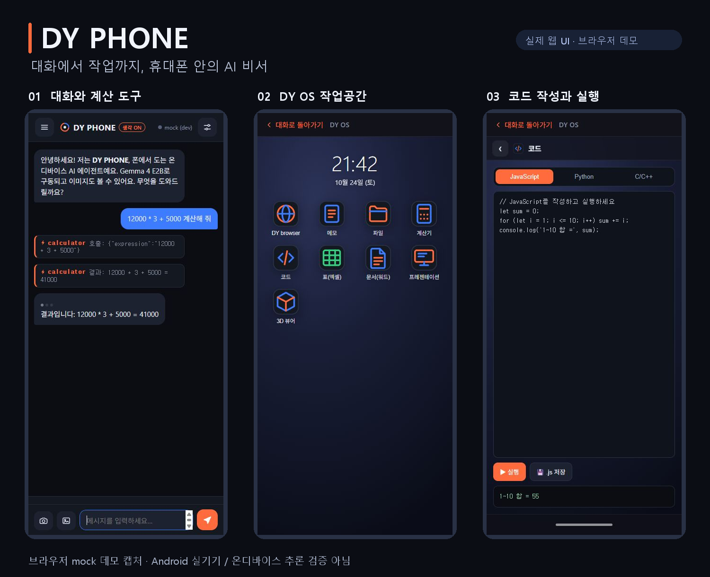

# DY PHONE

**휴대폰에서 AI와 대화하고, 파일·문서·코드 작업까지 한곳에서.**

DY PHONE은 Android 온디바이스 AI 비서와 **DY OS 가상 작업공간**을 결합한 앱입니다. 대화 화면에서 질문하고, 앱 안의 브라우저·메모·파일·계산기·코드·문서 도구를 열어 작업할 수 있습니다.

An Android AI assistant with on-device model integration and an in-app workspace for everyday tasks.



> **미리보기 안내:** 위 이미지는 이 저장소의 실제 웹 UI를 휴대폰 크기(412 × 892)로 실행해 캡처했습니다. 대화는 `mock (dev)` 데모 백엔드의 계산 도구 예시입니다. Android 실기기 캡처나 온디바이스 모델 추론 성능의 증거가 아닙니다.

[브라우저에서 실행하기](#브라우저에서-실행하기) · [Android 빌드](#android-빌드) · [확인한 범위](docs/VALIDATION.md)

## 이런 작업을 한 앱에서

| 하고 싶은 일 | DY PHONE에서 쓰는 화면 |
| --- | --- |
| 질문하고 계산 결과 확인하기 | 대화, 도구 호출, 생각 모드 전환 |
| 필요한 작업 도구 모아 쓰기 | DY OS 홈의 앱 목록 |
| 메모와 파일 다루기 | 메모, 파일 목록, 형식별 미리보기 |
| 짧은 코드를 작성하고 실행하기 | JavaScript·Python·C/C++ 코드 화면 |
| 표·문서·발표자료 만들기 | 표(엑셀), 문서(워드), 프레젠테이션 화면 |
| 이미지와 3D 파일 열기 | 이미지 첨부, 파일 미리보기, 3D 뷰어 |

DY OS는 **이 앱 안의 작업공간**입니다. 다른 Android 앱 전체를 자동으로 조작하는 시스템 런처가 아닙니다. 기능과 파일 형식에 따라 네이티브 플러그인 또는 번들 라이브러리가 필요합니다.

## 브라우저에서 실행하기

Node.js와 npm이 필요합니다.

```sh
git clone https://github.com/DY-AGENT/DY-PHONE.git
cd DY-PHONE
npm ci
npm run serve
```

브라우저에서 [http://localhost:8080](http://localhost:8080)을 엽니다.

- 처음에는 `mock (dev)`로 실행됩니다. 실제 AI 모델 없이 UI와 계산·시간 도구 흐름을 확인할 수 있습니다.
- 메뉴 → **가상 OS 열기**에서 작업공간을 엽니다.
- 설정에서 OpenAI 호환 엔드포인트를 지정하면 개발용 모델 서버를 사용할 수 있습니다. 이 경우 대화와 첨부 데이터가 지정한 서버로 전송될 수 있습니다.
- 브라우저 데모는 Android의 네이티브 파일·전화·모델 기능을 모두 제공하지 않습니다.

## Android 빌드

이 저장소는 **소스 코드 배포**입니다. 이 최초 공개에는 검증된 설치용 APK가 포함되어 있지 않습니다.

준비: Node.js, JDK 17, Android SDK Platform 34 및 Android 빌드 도구.

```sh
npm ci
npx cap sync android
cd android
```

Windows PowerShell:

```powershell
.\gradlew.bat assembleRelease
```

macOS / Linux:

```sh
chmod +x gradlew
./gradlew assembleRelease
```

빌드 성공 시 APK 위치:

```text
android/app/build/outputs/apk/release/app-arm64-v8a-release.apk
android/app/build/outputs/apk/release/app-universal-release.apk
```

별도 서명 설정이 없으면 기존 빌드 설정은 테스트용 디버그 키를 사용합니다. 배포용 서명은 Git에서 제외된 `android/keystore.properties` 또는 `DYAGENT_STORE_FILE`, `DYAGENT_STORE_PASSWORD`, `DYAGENT_KEY_ALIAS`, `DYAGENT_KEY_PASSWORD` 환경변수로 설정합니다. 비밀번호나 서명 키를 저장소에 올리지 마세요.

### 온디바이스 모델

소스는 **Gemma 4 E2B + LiteRT-LM** 네이티브 연결을 포함하며 모델 파일은 동봉하지 않습니다. 앱에 설정된 다운로드 파일은 약 3GB이며, 화면에는 4GB 이상 여유 공간을 안내합니다. 실제 메모리 요구량·호환성·처리 속도는 기기에 따라 확인해야 합니다. 모델 배포처의 접근 및 이용 조건은 앱 소스와 별개입니다.

모델을 준비한 뒤 로컬 추론을 사용하도록 설계되어 있습니다. 모델 다운로드, 웹 탐색, HTTP 도구, 개발용 모델 서버를 사용할 때는 네트워크가 필요합니다.

## 구조

```text
www/                 대화 UI, 에이전트 루프, 도구, 로컬 메모리
www/vos/             DY OS 작업공간
www/vendor/          번들 외부 라이브러리
android/             Capacitor Android 프로젝트와 네이티브 플러그인
android-plugin/      네이티브 플러그인 참조 사본과 통합 설명
resources/           기존 아이콘 원본
docs/images/         실제 웹 UI 캡처와 미리보기 이미지
```

앱 표시 이름은 **DY PHONE**입니다. 기존 설치와의 연속성을 위해 Android application ID(`com.dyagent.mobile`)와 내부 저장 키는 유지했습니다. 기존 앱 업데이트에는 동일한 서명 키도 필요합니다.

## 라이선스

DY PHONE의 앱 코드는 [MIT 라이선스](LICENSE)로 배포합니다. Copyright (c) 2026 DY-AGENT.

번들 외부 라이브러리, 네이티브 런타임, 별도로 받는 모델에는 각 배포처의 라이선스와 조건이 적용됩니다. 기존 외부 라이브러리의 저작권·라이선스 헤더는 유지했습니다.
